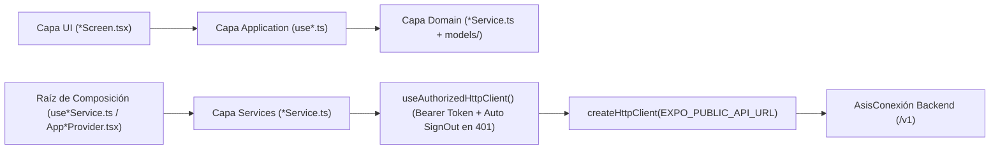

# Guía Completa de Integración Frontend ↔ Backend (`AsisConexión`)

Este documento detalla de extremo a extremo todas las conexiones HTTP implementadas en el repositorio móvil (`Frontend-Asisconnection`) hacia el backend desplegado en Render (`https://asisconection.onrender.com/v1`), especificando por cada módulo:
1. **Qué endpoints consume y qué método HTTP utiliza**.
2. **Qué datos envía el Frontend (Request Body / Query Params)**.
3. **Qué datos entrega el Backend (Response DTO) y cómo se transforman a los modelos de dominio**.
4. **Reglas de negocio, moderación y privacidad (Ley 1581 / Ley 1098) aplicadas**.

---

## 1. Arquitectura de Comunicación HTTP

Toda la comunicación con el servidor pasa exclusivamente por `src/shared/lib/http/createHttpClient.ts` (vigilado por ESLint: está prohibido usar `fetch` fuera de `shared/lib/http`):



- **Inyección automática de sesión**: `useAuthorizedHttpClient()` adjunta `Authorization: Bearer <device_token>` leído desde `expo-secure-store`.
- **Expiración de sesión (`401 Unauthorized`)**: si cualquier endpoint protegido responde `401`, `useAuthorizedHttpClient()` limpia automáticamente el token de `expo-secure-store` y redirige al usuario a `(auth)/login`.
- **Desempaquetado de paginación**: todas las listas del backend devuelven `{ data: T[], meta: PaginationMetaDto }`; los `services/` de cada módulo desempaquetan `response.data` y entregan arreglos tipados a la capa `application/`.

---

## 2. Mapa General de Endpoints Consumidos por Módulo

| Módulo Frontend | Archivo `services/` | Método y Endpoint (`/v1/...`) | Qué envía el Front | Qué recibe del Back |
|---|---|---|---|---|
| **Auth** (`src/modules/auth`) | `authService.ts` | `POST /auth/login` | `{ email, clave, accept_consent: true }` | `{ device_token, user, synced_with_global_db }` |
| **Auth** (`src/modules/auth`) | `authService.ts` | `POST /auth/registro` | `{ username, email, clave, rol, accept_consent: true }` | `{ device_token, user, synced_with_global_db }` |
| **Auth** (`src/modules/auth`) | `authService.ts` | `POST /sessions/anonymous` | `{ accept_consent: true, nickname?, role_tag? }` | `{ device_token, session_id }` |
| **Auth** (`src/modules/auth`) | `authService.ts` | `GET /actors/me` | Header `Bearer <token>` | `{ id, username, primary_role, ... }` |
| **Forum** (`src/modules/forum`) | `forumService.ts` | `GET /categories?page=1&limit=50` | Query `page`, `limit` | `{ data: CategoryItemDto[], meta }` |
| **Forum** (`src/modules/forum`) | `forumService.ts` | `GET /posts?page=1&limit=20&categoryId=...` | Query `page`, `limit`, `categoryId?` | `{ data: PublicPostItemDto[], meta }` |
| **Forum** (`src/modules/forum`) | `forumService.ts` | `POST /posts/:postId/reactions` | `{ type: 'LIKE' }` | `{ post_id, type, active }` |
| **Forum (Moderación)** (`src/modules/forum`) | `forumService.ts` | `GET /admin/moderation/pending?page=1&limit=50` | Header `Bearer <token>` (`ADMIN` / `MODERATOR`) | `{ data: ModerationPendingItemDto[], meta }` |
| **Forum (Moderación)** (`src/modules/forum`) | `forumService.ts` | `PATCH /admin/moderation/posts/:id/status` | `{ status: 'APPROVED' \| 'REJECTED' }` | `{ id, status, updated_at }` |
| **Forum (Moderación)** (`src/modules/forum`) | `forumService.ts` | `PATCH /admin/moderation/comments/:id/status` | `{ status: 'APPROVED' \| 'REJECTED' }` | `{ id, status, updated_at }` |
| **Posts** (`src/modules/posts`) | `postsService.ts` | `POST /posts` | `{ category_id, content, image_url?, media_urls? }` | `{ id, status, rejection_reason?, message, created_at }` |
| **Comments** (`src/modules/comments`) | `commentsService.ts` | `GET /posts/:postId/comments?page=1&limit=50` | Query `page`, `limit` | `{ data: ApprovedCommentItemDto[], meta }` |
| **Comments** (`src/modules/comments`) | `commentsService.ts` | `POST /posts/:postId/comments` | `{ content, parent_id? }` | `{ id, status, rejection_reason?, message, created_at }` |
| **Comments** (`src/modules/comments`) | `commentsService.ts` | `POST /comments/:id/reactions` | `{ type: 'LIKE' }` | `{ comment_id, type, active }` |
| **Profile** (`src/modules/profile`) | `profileService.ts` | `GET /actors/me` | Header `Bearer <token>` | `ActorProfileResponseDto` (con `email`, `birth_date`, `city`, switches y contadores) |
| **Profile** (`src/modules/profile`) | `profileService.ts` | `PATCH /actors/me` | `{ first_names?, last_names?, avatar_url?, short_bio?, birth_date?, city?, show_email?, show_birth_date?, show_city?, require_follow_approval? }` | `ActorProfileResponseDto` actualizado |
| **Profile** (`src/modules/profile`) | `profileService.ts` | `GET /actors/:id` | Path `id` (UUID) | `ActorProfileResponseDto` (con privacidad Ley 1581 filtrada según switches del titular) |
| **Profile** (`src/modules/profile`) | `profileService.ts` | `POST /connections` | `{ receiver_actor_id }` | `{ id, status, requested_at, accepted_at }` |
| **Profile** (`src/modules/profile`) | `profileService.ts` | `GET /actors/me/posts?page=1&limit=20` | Query `page`, `limit` | `{ data: PublicPostItemDto[], meta }` |
| **Settings** (`src/modules/settings`) | `settingsService.ts` | `GET /actors/me` & `PATCH /actors/me` | `{ show_email?, show_birth_date?, show_city?, require_follow_approval? }` | `PrivacySettings` persistidos en `ASISCONEXION_DB` |
| **Assistant** (`src/modules/assistant`) | `assistantService.ts` | `GET /assistant/faqs?page=1&limit=50` | Query `page`, `limit`, `category?` | `{ disclaimer, data: FaqItemDto[], meta }` |
| **Assistant** (`src/modules/assistant`) | `assistantService.ts` | `POST /assistant/escalate` | `{ topic? }` | `{ whatsapp_url, support_message }` |
| **Ecosystem** (`src/modules/ecosystem`) | `ecosystemService.ts` | `GET /directory/links?page=1&limit=50` | Query `page`, `limit` | `{ data: RedirectionLinkItemDto[], meta }` (5 proyectos: SUMA 21, AULA UP, SAGA-UP, SON UP, LUPE) |
| **Notifications** (`src/modules/notifications`) | `notificationsService.ts` | `GET /notifications?page=1&limit=50` | Query `page`, `limit` | `{ data: NotificationItemDto[], meta }` |
| **Notifications** (`src/modules/notifications`) | `notificationsService.ts` | `PATCH /notifications/read-all` | Header `Bearer <token>` | `{ marked_read: true, updated_at }` |

---

## 3. Detalle de Integración por Módulo

### 3.1. Módulo `auth` (`src/modules/auth`)
- **Cambios realizados**:
  - Se incorporó `ConsentCheckbox.tsx` en `LoginScreen.tsx` para exigir `accept_consent: true` (cumplimiento estricto de la Ley 1581 de 2012 y Ley 1098 de 2006).
  - Se alinearon los códigos de rol (`ADMIN`, `MODERATOR`, `ACUDIENTE`, `VOLUNTARIO`, `INVERSOR`, `BENEFICIARIO`) en `src/shared/domain/models/RoleCode.ts` y `src/modules/auth/domain/models/Role.ts`.
  - Se adaptó `authService.ts` para leer errores en formato RFC 7807 (`errors: [{ field, message }]`) y traducir `502 Bad Gateway` (caída o rate-limit del servicio central de identidad en Render) a `AuthError('network')`.
  - Se añadieron los métodos `register` (`POST /auth/registro`) y `loginAnonymous` (`POST /sessions/anonymous`) en `authService.ts`, además de las acciones listas para consumir desde la UI en `AuthProvider.tsx` (`signInAnonymous`, `register`) y `useLogin.ts` (`submitAnonymous`).

### 3.2. Módulos `forum` y `posts` (`src/modules/forum`, `src/modules/posts`)
- **Mapeo de Categorías (`toCategoryCode`)**:
  - El backend almacena las 4 categorías con UUID y nombre en base de datos (`Noticias`, `Salud`, `Apoyo Pedagógico`, `Voluntariado`).
  - `src/shared/domain/models/CategoryCode.ts` define `toCategoryCode(name, mainTopic)` para asociar cada categoría del backend con su clave visual y paleta de colores del tema:
    - `Noticias` (`Institucional`) → `'announcements'`
    - `Salud` (`Bienestar y Salud`) → `'questions'`
    - `Apoyo Pedagógico` (`Educación`) → `'guides'`
    - `Voluntariado` (`Participación Social`) → `'achievements'`
- **Feed del Foro (`forumService.ts`)**:
  - Carga y cachea en memoria `GET /categories` para traducir entre `CategoryCode` y el UUID `category_id`.
  - Consume `GET /posts?page=1&limit=20` (y `&categoryId=<uuid>` al filtrar por chip).
  - Suma `reactions_summary.LIKE + SUPPORT + THANKS` en `likeCount` y conecta el botón de reacción a `POST /posts/:postId/reactions` con `{ type: 'LIKE' }`.
- **Cola de Moderación Humana (`useModerationQueue.ts`)**:
  - Para usuarios con rol `ADMIN` o `MODERATOR`, el hook `useModerationQueue(repository, isEnabled)` consulta `GET /admin/moderation/pending`, expone acciones `approve(id, itemType)` y `reject(id, itemType)` (`PATCH /admin/moderation/posts/:id/status` o `PATCH /admin/moderation/comments/:id/status`), e invalida automáticamente la caché del foro (`['forum']`) tras aprobar o rechazar contenido.
- **Creación de Publicaciones y Moderación en Dos Capas (`postsService.ts` + `NewPostScreen.tsx`)**:
  - Al publicar (`POST /posts`), el backend pasa el texto por `ContentFilterService` (Capa 1: filtro automático de groserías, enlaces externos, datos sensibles de menores y spam) y, si pasa, lo deja en `status = 'PENDING'` (Capa 2: moderación humana por `ADMIN` o `MODERATOR`).
  - `NewPostScreen` informa al usuario con el mensaje devuelto por el backend (*«Contenido recibido y enviado a moderación humana antes de su publicación»* o el motivo de rechazo automático) e invalida la caché del feed (`['forum', 'posts']`).

### 3.3. Módulo `comments` (`src/modules/comments`)
- **Listado de comentarios (`GET /posts/:postId/comments`)**:
  - Devuelve únicamente comentarios con `status = 'APPROVED'`, incluyendo `parent_id` (para respuestas anidadas), `likes_count` y `author` enriquecido (`actor_id`, `display_name`, `role_label`, `avatar_url`, `is_registered`).
  - Mientras el backend en Render termina de redesplegarse, `commentsService.ts` cuenta con fallback automático a `recent_comments` de `GET /posts` si recibe `404`.
- **Creación de comentarios (`POST /posts/:postId/comments`)**:
  - Envía `{ content }` para comentarios raíz y `{ content, parent_id }` para respuestas a otro comentario (omitiendo `parent_id` cuando es `null` para cumplir con `@IsUUID()` en el DTO del backend).
  - Muestra alerta informando que el comentario fue enviado a revisión de moderación (`PENDING`).
- **Reacciones en comentarios (`POST /comments/:id/reactions`)**:
  - Envía `{ type: 'LIKE' }` y actualiza el estado del corazón en `CommentItem.tsx`.

### 3.4. Módulos `profile` y `settings` (`src/modules/profile`, `src/modules/settings`)
- **Perfil propio (`profileService.ts` + `useMyProfile.ts`)**:
  - Consume `GET /actors/me` (que devuelve `email`, `birth_date`, `city`, los switches de privacidad y los contadores reales `posts_count`, `followers_count` y `following_count` al titular de la sesión).
  - Consume `GET /actors/me/posts` para listar las publicaciones propias aprobadas.
  - Incluye `updateMyProfile` conectado a `PATCH /actors/me`.
- **Perfil público de otra persona y Seguir (`usePublicProfile.ts`)**:
  - Consume `GET /actors/:id` (donde el backend oculta `email`, `birth_date` o `city` si el titular tiene apagados sus switches Ley 1581) y expone `follow()` conectado a `POST /connections` (`{ receiver_actor_id }`).
- **Ajustes de privacidad (`SettingsScreen.tsx` + `settingsService.ts` + `src/app/profile/settings.tsx`)**:
  - Todos los interruptores de datos sensibles (`showEmail`, `showBirthDate`, `showCity`, `requireFollowApproval`) inician en `false` (*«Solo yo»*) por mandato de la Ley 1581 de 2012 y se sincronizan de forma optimista con `GET /actors/me` y `PATCH /actors/me`.
  - Incluye vista previa en tiempo real (*«Así te ven los demás»*) y botón *«Cerrar sesión»* conectado a `useAuth().signOut()`.

### 3.5. Módulo `assistant` (`src/modules/assistant`)
- **Motor de Reglas FAQ (`GET /assistant/faqs`)**:
  - Carga las preguntas frecuentes agrupadas por `category` junto con el `disclaimer` legal obligatorio (`ASSISTANT_DISCLAIMER`) que advierte que la orientación automatizada no reemplaza la atención profesional de la Fundación ASISCO UP.
- **Derivación humana (`POST /assistant/escalate`)**:
  - Genera el enlace oficial de WhatsApp (`whatsapp_url`) con el tema consultado (`topic`) y lo abre mediante `Linking.openURL`.

### 3.6. Módulo `ecosystem` (`src/modules/ecosystem`)
- **Directorio de proyectos satélites (`GET /directory/links`)**:
  - Obtiene los enlaces activos (`project_name`, `url`, `description`) de los 5 sistemas del ecosistema (`SUMA 21`, `AULA UP`, `SAGA-UP`, `SON UP`, `LUPE`) y habilita la apertura externa desde cada `EcosystemCard`.

### 3.7. Módulo `notifications` (`src/modules/notifications`)
- **Actividad reciente (`GET /notifications` y `PATCH /notifications/read-all`)**:
  - Obtiene las notificaciones de actividad comunitaria sobre las publicaciones del usuario en los últimos 30 días.
  - `groupNotificationsByPeriod` clasifica cada notificación en `Hoy`, `Ayer`, `Últimos 7 días` y `Últimos 30 días`, descartando cualquier registro con más de 30 días de antigüedad.
  - El botón *«Marcar leídas»* invoca `PATCH /notifications/read-all` y actualiza el estado visual a *«Leídas»*.

---

## 4. Ejecución Local y Despliegue en Render (Web + Móvil)

### 4.1. Ejecución Local
El frontend funciona a nivel local apuntando directamente al backend en Render (o a un backend local en `http://localhost:3000/v1` cambiando `EXPO_PUBLIC_API_URL` en `.env`):
```bash
# Servidor de desarrollo (Expo Go en iOS/Android, simulador o navegador web)
npx expo start

# Abrir directamente en versión Web local
npx expo start --web
```

### 4.2. Despliegue Web en la misma cuenta de Render (con Dominio Personalizado)
Como el proyecto utiliza **Expo Router** con `web.output: "static"` configurado en `app.json`, se puede desplegar como un **Static Site** en la misma cuenta/proyecto de **Render** donde está alojado el backend (sin costo adicional en el plan gratuito de Static Sites de Render):

1. En el panel de **Render**, haz clic en **New + → Static Site** y conecta el repositorio de GitHub del frontend (`Frontend-Asisconnection`).
2. Configura los parámetros del servicio:
   - **Branch**: `main` (o la rama de despliegue acordada).
   - **Build Command**: `npm ci && npx expo export --platform web`
   - **Publish Directory**: `dist`
3. En **Environment Variables** del Static Site en Render, agrega:
   - `EXPO_PUBLIC_API_URL` = `https://asisconection.onrender.com/v1`
4. En **Redirects/Rewrites** del Static Site en Render, añade una regla para que las rutas dinámicas de Expo Router funcionen al recargar la página (SPA fallback):
   - **Source**: `/*`
   - **Destination**: `/index.html`
   - **Action**: `Rewrite`
5. **Dominio personalizado**: En la pestaña **Settings → Custom Domains** del Static Site en Render, agrega tu dominio o subdominio (por ejemplo `app.asisco.org` o `asisconexion.org`) y apunta el registro `CNAME` / `A` en tu proveedor DNS hacia el destino que indica Render (Render emite y renueva el certificado SSL/HTTPS automáticamente).
   - Recuerda también agregar ese dominio en la variable de entorno `CORS_ORIGINS` del servicio Backend en Render para permitir peticiones cross-origin desde el navegador web.

### 4.3. Despliegue Móvil Nativo (Android APK/AAB e iOS)
Para distribuir el instalable móvil nativo a los miembros de la fundación:
```bash
npx eas-cli@latest build --platform android --profile preview
```
Esto genera un enlace descargable (`.apk`) a través de **Expo Application Services (EAS)** conectado a `https://asisconection.onrender.com/v1`.
